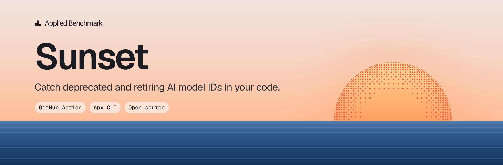
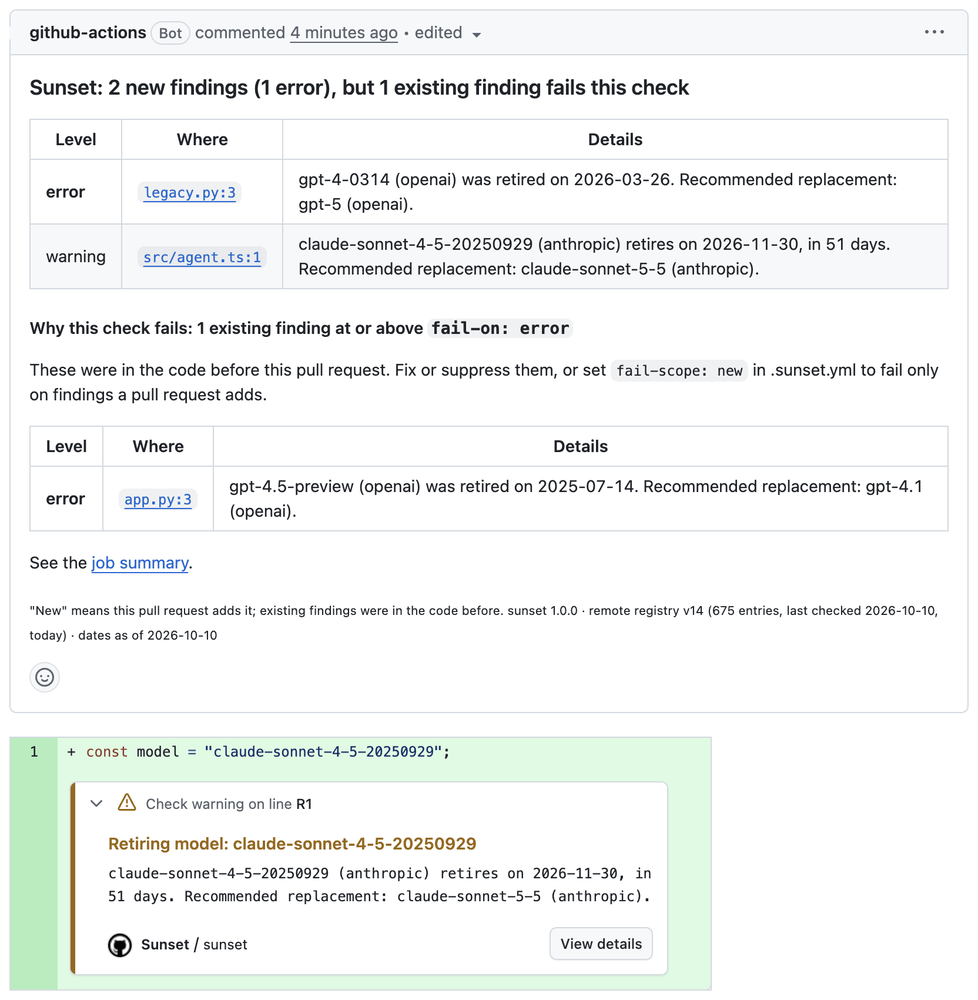

# Sunset

<p align="center"></p>

[](https://github.com/AppliedBenchmark/sunset/actions/workflows/ci.yml?query=branch%3Amain)
[](https://www.npmjs.com/package/@appliedbenchmark/sunset)
[](https://scorecard.dev/viewer/?uri=github.com/AppliedBenchmark/sunset)
[](LICENSE)

Catch deprecated and retiring AI model IDs in your code, with dates quoted from each provider's official page.

Sunset scans a repository for model IDs (`gpt-4.5-preview`, `claude-3-5-haiku-20241022`,
`anthropic.claude-3-haiku-20240307-v1:0`, Azure deployments, …) and checks each one against a registry of
lifecycle dates. It runs as a GitHub Action or from the command line. It doesn't use an LLM, collects no
telemetry, and never uploads your code.

```
$ npx @appliedbenchmark/sunset scan
Errors (1)

  error   app.py:3:46  model-retired
    gpt-4.5-preview (openai) was retired on 2025-07-14. Recommended replacement: gpt-4.1 (openai).

Warnings (1)

  warning src/agent.ts:4:16  model-retiring
    claude-sonnet-4-5-20250929 (anthropic) retires on 2026-11-30, in 51 days. Recommended replacement: claude-sonnet-5-5 (anthropic).

1 error, 1 warning, 0 notices
Scanned 2 files on 2026-10-10 with sunset 1.0.0, remote registry v14 (675 entries, last checked 2026-10-10, today).
```

Covered platforms:

- OpenAI
- Anthropic
- Gemini API
- Vertex AI (Gemini Enterprise Agent Platform)
- Amazon Bedrock
- Azure OpenAI (`azure-openai`, which covers every model on Microsoft Foundry's retirement schedule)
- Mistral
- DeepSeek, on a best-effort basis

Slugs on OpenRouter and the Vercel AI Gateway (`<vendor>/<first-party ID>`) get the upstream model's dates,
as a warning at most ([details](docs/limitations.md#openrouter-and-the-vercel-ai-gateway)).

## Quickstart

### GitHub Action

Add `.github/workflows/sunset.yml`:

```yaml
name: Sunset

on:
  pull_request:
  push:
    branches: [main]
  schedule:
    - cron: '0 6 * * 1' # weekly: retirement dates arrive without any code change

permissions:
  contents: read

concurrency:
  group: sunset-${{ github.event.pull_request.number || github.ref }}
  cancel-in-progress: true

jobs:
  sunset:
    runs-on: ubuntu-latest
    permissions:
      contents: read
      pull-requests: write # the PR comment
      security-events: write # the SARIF upload
      actions: read # the SARIF upload, in private repositories only
    steps:
      - uses: actions/checkout@v7
        with:
          persist-credentials: false
      - uses: AppliedBenchmark/sunset@v1
        with:
          sarif-file: sunset.sarif
      - uses: github/codeql-action/upload-sarif@v4
        if: ${{ !cancelled() && hashFiles('sunset.sarif') != '' }}
        with:
          sarif_file: sunset.sarif
```

The run fails on errors (retired models, or retirement in under 30 days), annotates the findings, writes a
job summary, and on pull requests keeps one comment up to date with the findings the pull request adds.
Sunset doesn't need the credentials that `actions/checkout` would store: when it has to fetch the base commit
of a pull request, it passes the token to git itself.



The last step is optional: it shows the findings under **Security → Code scanning**. Code scanning is free
on public repositories; private ones need GitHub Code Security. Without it, drop the step,
`security-events: write` and `actions: read`. See [docs/code-scanning.md](docs/code-scanning.md).

- In a public repository, GitHub disables scheduled workflows after 60 days without repository activity
  ([GitHub docs](https://docs.github.com/en/actions/how-tos/manage-workflow-runs/disable-and-enable-workflows)).
  If that happens, enable the workflow again under **Actions**.
- The Action runs on Node 24, so self-hosted runners need Actions Runner 2.327.1 or later
  ([actions/checkout](https://github.com/actions/checkout#checkout-v5) has the same requirement).

### CLI

```sh
npx @appliedbenchmark/sunset scan
```

Needs Node.js 22.13 or later. Use `--format json`, `sarif` or `markdown` for a report, and
`--registry bundled` to make no network calls at all.

## What it reports

| Rule | Level |
|---|---|
| `model-retired` | error |
| `model-retiring` | error under 30 days, warning under 90 days |
| `model-deprecated` | notice |
| `model-unverified`, `model-reference-unresolved`, `model-id-unknown`, `suppression-expired` | notice |
| `model-legacy` | notice, only with `legacy: true` |

Model IDs in documentation (`*.md`, `docs/**`, …) are listed as mentions and never fail a run. Model names
read from the environment or a variable are reported as unresolved instead of being skipped silently.
[docs/rules.md](docs/rules.md) explains each rule and what to do about it.

## Configuration

Sunset works without configuration. To change what fails the run, or to scan less, add `.sunset.yml`:

```yaml
fail-on: warning          # error (default), warning or never
fail-scope: new           # on pull requests, fail only on findings the pull request adds
platforms: [openai, bedrock]
exclude: [examples/**]
ignore:
  - models: [gpt-4-0613]
    until: 2027-01-31
    reason: 'migration tracked in #123'
```

Quote a value that contains ` #` or starts with `*`. YAML reads everything after ` #` as a comment, and a
leading `*` as an alias, so `reason: migration tracked in #123` would lose `#123`.

Or suppress one line with a comment: `# sunset-ignore-next-line until=2027-01-31 reason="pinned for evals"`.

Every key, the Action's inputs and the CLI's flags are in [docs/configuration.md](docs/configuration.md),
and so are the Action's [outputs](docs/configuration.md#outputs) (`errors`, `warnings`, `notices`, …).

## Versions

- `AppliedBenchmark/sunset@v1` follows the latest 1.x release.
- Each `vX.Y.Z` is an
  [immutable release](https://docs.github.com/en/code-security/concepts/supply-chain-security/immutable-releases):
  its tag and files can't change once it's published. The
  [release notes](https://github.com/AppliedBenchmark/sunset/releases) list what changed.
- To pin the Action to a commit, as GitHub
  [recommends](https://docs.github.com/en/actions/reference/security/secure-use#using-third-party-actions)
  for third-party actions, use the release's full commit SHA with the version in a comment. Dependabot
  updates both. `gh api repos/AppliedBenchmark/sunset/commits/v1.0.0 --jq .sha` prints the SHA.

  ```yaml
  - uses: AppliedBenchmark/sunset@<full commit SHA> # v1.0.0
  ```

- Pinning fixes the code, not the data: the scan still fetches the latest registry unless you set
  `registry: bundled`.
- For the CLI, `npx @appliedbenchmark/sunset@1 scan` runs the latest 1.x release, and `@1.0.0` an exact one.

## The registry

[`registry/models.yaml`](registry/models.yaml) lists each model ID with its status, dates and replacements,
plus a word-for-word excerpt from the provider's page and a link to it. CI checks every excerpt against a
stored copy of that page. A scheduled workflow fetches the official pages every day and opens a pull request
when they change; a maintainer reviews each one.

By default, a scan fetches the latest registry from this repository and falls back to the copy that comes
with the release if the fetch fails or the file doesn't validate. For an air-gapped setup, use
`registry: bundled` or a local path. [docs/registry.md](docs/registry.md) has the schema and the rules for
adding an entry. To report a wrong date, use the
[registry correction form](https://github.com/AppliedBenchmark/sunset/issues/new?template=registry-correction.yml).

## Limitations

- **Only IDs in the registry are checked.** Other IDs produce no finding, though IDs that look like a known
  model family are listed in the JSON report's `inventory`.
- **Models chosen at run time** (from an environment variable, a variable or an interpolated string) can't be
  checked. They are reported as unresolved references, which never fail a run.
- **Azure deployments** are matched by model name and version in Terraform, Bicep, ARM templates and `az`
  commands. A deployment name you chose in application code doesn't say which model it runs.
- **Routers** (OpenRouter, the Vercel AI Gateway) are checked only for `<vendor>/<first-party ID>` slugs,
  as a warning at most.
- **Tests and data files are scanned like code**, and fixtures often name retired models on purpose.
  Leave them out with `exclude` (for example `'**/{test,tests,fixtures}/**'`).

[docs/limitations.md](docs/limitations.md) covers each of these in full, plus the supported file types and
how notebooks, command lines, paths, URLs and sentences are read.

## Privacy

The scan reads your files locally. It collects no telemetry, doesn't use an LLM, and never uploads your
code. Its network calls are:

- the registry fetch from `raw.githubusercontent.com` (none with `registry: bundled` or a local path);
- in the Action, on a pull request whose base commit isn't in the checkout, a `git fetch` of that commit
  from your repository, with the workflow's token;
- in the Action, the GitHub API calls that create or update the pull request comment, which shows findings
  on that pull request.

[SECURITY.md](SECURITY.md#what-leaves-your-machine) lists each request and what it contains.

## Getting help

- **Questions and bugs:** [open an issue](https://github.com/AppliedBenchmark/sunset/issues/new/choose).
- **A wrong or missing date:** use the
  [registry correction form](https://github.com/AppliedBenchmark/sunset/issues/new?template=registry-correction.yml).
- **A security vulnerability:** report it privately, as [SECURITY.md](SECURITY.md) describes, not in an
  issue.

## More

- [Contributing](CONTRIBUTING.md) and the [code of conduct](CODE_OF_CONDUCT.md)
- [Release notes](https://github.com/AppliedBenchmark/sunset/releases)
- [Roadmap](ROADMAP.md)
- [Security policy](SECURITY.md)
- [Maintainers' guide](docs/maintainers.md)
- [Architecture](docs/architecture.md)

## License

[Apache-2.0](LICENSE)
